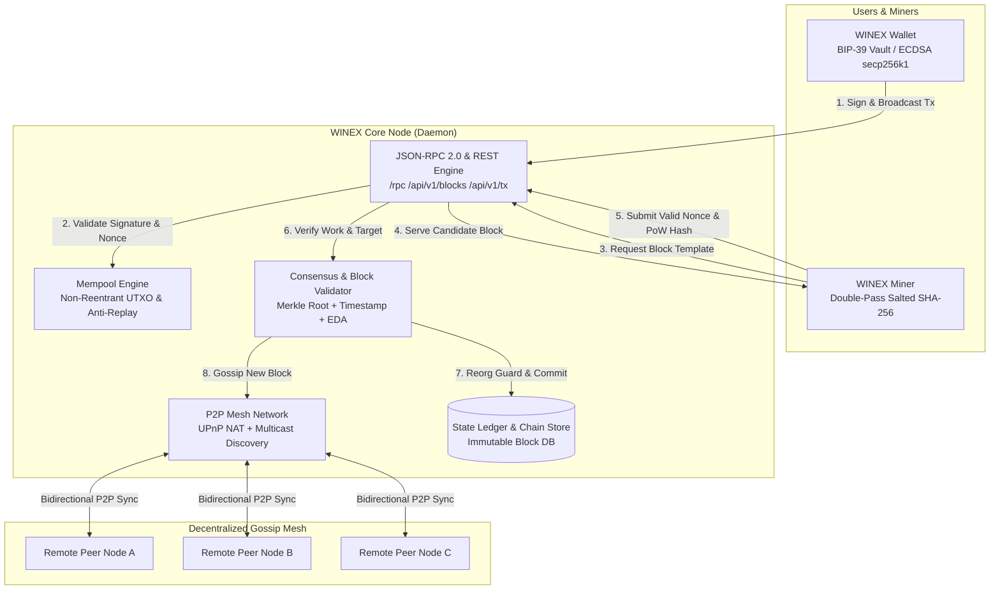

# WINEX Core (WNX)

[](https://opensource.org/licenses/MIT)
[](https://golang.org)
[](#consensus-protocol)
[](#economic-model)

**WINEX** is an autonomous, decentralized Layer-1 proof-of-work blockchain network engineered for long-term cryptographic scarcity, deterministic block issuance, and sovereign peer-to-peer digital settlement.

---

## Key Highlights

- **Strict Supply Hard Cap:** Mathematically enforced maximum lifetime supply of **12,100,000 WNX**.
- **Predictable Halving Protocol:** Block rewards begin at **40.0 WNX** and halve every **125,000 blocks** (~3.56 years).
- **Sub-Satoshi Divisibility:** Minimal transfer granularity down to **0.00000001 WNX** (8 decimal places).
- **Deterministic Salted PoW:** Double-pass SHA-256 with address-bound salting and dynamic Emergency Difficulty Adjustment (EDA).
- **Sovereign Non-Custodial Architecture:** BIP-39 deterministic seed phrase derivation, cold AES-256-GCM vault encryption, and zero third-party dependencies.
- **Kernel-Level Memory Hardening:** Proactive RAM zeroization (`purgeSensitiveMemoryLocked`) upon lock and `PR_SET_DUMPABLE=0` anti-ptrace core dump immunity.
- **P2P Mesh Traversal:** Automatic UPnP router mapping and LAN multicast discovery (`239.255.255.250:1900`) for seamless peer connectivity across NAT/firewalls.

---

## System Architecture & How the Node Network Works

WINEX is organized into modular subsystems written in Go, operating as a decentralized peer-to-peer consensus network:



### Node Network Mechanics

1. **P2P Mesh Discovery & Synchronization:**
   - Nodes discover peers via UPnP NAT port-mapping, local subnet multicast beaconing, and distributed DNS seeds.
   - Longest-chain consensus is verified upon handshake. Reorganizations are bounded to a maximum depth of 10 blocks (`MAX_REORG_DEPTH = 10`) to eliminate 51% history rewrite attacks.

2. **Transaction Execution & Mempool:**
   - Transactions are digitally signed using standard **ECDSA secp256k1** with RFC 6979 deterministic `k`-values.
   - Nodes verify input balances, deduct transfers down to `0.00000001 WNX`, and check nonce deduplication before admitting transactions into the mempool.

3. **Mining & Difficulty Consensus:**
   - Miners pull candidate block templates containing pending transactions and the parent block hash.
   - Hashing utilizes double-pass salted SHA-256: `SHA256(SHA256(BlockHeader + Nonce + MinerAddress))`.
   - Difficulty recalculates dynamically based on a rolling moving average to maintain the target 15-minute block interval.

---

## Technology Stack & Languages

| Component | Technology | Description |
| :--- | :--- | :--- |
| **Core Systems Language** | **Go (Golang 1.23+)** | High-performance compiled language chosen for concurrent goroutines, zero-overhead garbage collection, and native cross-platform compilation. |
| **Consensus Cryptography** | **Double-Pass SHA-256** | Salted proof-of-work algorithm engineered for CPU/GPU parallel verification. |
| **Signature Scheme** | **secp256k1 ECDSA** | Industrial-grade elliptic curve cryptography for non-custodial address ownership. |
| **Key Derivation** | **BIP-39 / PBKDF2** | 12-word mnemonic seed generation with cryptographic key stretching (100,000 iterations). |
| **Vault Encryption** | **AES-256-GCM** | Authenticated hardware-accelerated symmetric cipher protecting keystores on disk. |
| **OS Memory Defense** | **Linux `sys_prctl` (PR_SET_DUMPABLE=0)** | Kernel-level protection against `gdb`, `ptrace`, and `/proc/$PID/mem` memory dumping. |
| **Network Protocols** | **TCP / UPnP / JSON-RPC 2.0** | Non-blocking socket communication, automated NAT traversal, and standard RPC interfaces. |

---

## Economic Model & Consensus Parameters

| Metric | Specification |
| :--- | :--- |
| **Consensus Algorithm** | Double-Pass Salted SHA-256 Proof-of-Work |
| **Target Block Interval** | 15.0 Minutes (900 seconds) |
| **Initial Block Reward** | 40.0 WNX |
| **Halving Schedule** | Every 125,000 blocks (~3.56 years) |
| **Maximum Lifetime Supply** | **12,100,000 WNX** (Strict Hard Cap) |
| **Minimum Transfer Unit** | **0.00000001 WNX** (8 decimal places) |
| **Reorganization Guard** | Max Reorg Depth: 10 blocks |

---

## Repository Structure

```
WINEX_Core/
├── cmd/
│   ├── winex-node/         # Standalone Layer-1 P2P node daemon & consensus engine
│   ├── winex-wallet/       # Sovereign desktop wallet with AES-256-GCM cold vault
│   └── winex-miner/        # Dedicated GPU (OpenCL 3.0) & Multi-Core CPU mining engine
├── docs/
│   ├── ARCHITECTURE.md     # Detailed systems architecture & component flows
│   ├── CONSENSUS_SPEC.md   # Mathematical consensus & halving specifications
│   └── RPC_API.md          # Complete JSON-RPC 2.0 & REST API documentation
├── scripts/
│   ├── build_all.sh        # Unified cross-platform builder
│   ├── build_node.sh       # Node compiler
│   ├── build_wallet.sh     # Desktop wallet compiler
│   ├── build_miner.sh      # OpenCL/CPU miner compiler
│   └── build_windows.bat   # Windows native build script
├── go.work                 # Multi-module Go workspace
├── LICENSE                 # Standard MIT open-source license
├── SECURITY.md             # Responsible disclosure & vulnerability policy
└── CONTRIBUTING.md         # Contribution guidelines & code standards
```

---

## Quick Start: Building From Source

### Prerequisites
- **Go 1.23+** installed (`go version`).
- **OpenCL headers & drivers** (optional, required only for native GPU OpenCL mining).
- **Git**

### 1. Clone & Build All Components
```bash
git clone https://github.com/WinexCoin/winex-core.git
cd winex-core

# Make compilation scripts executable
chmod +x scripts/*.sh

# Build all binaries (Node, Wallet, Miner)
./scripts/build_all.sh
```
All compiled executables will be placed in the `bin/` directory.

---

## Running WINEX Components

### 1. Launching the Layer-1 Node (`winex-node`)
Run a sovereign full node daemon:
```bash
./bin/winex-node
```
Options:
- `--host <ip>` : Address to bind to (default: `127.0.0.1`, use `0.0.0.0` for public validator relays).
- `--port <port>` : HTTP and RPC listen port (default: `8081`).
- `--daemon` : Run in headless background daemon mode.

Verify node status via JSON-RPC:
```bash
curl -s -X POST http://127.0.0.1:8081/rpc \
  -H "Content-Type: application/json" \
  -d '{"jsonrpc":"2.0","method":"getinfo","params":[],"id":1}'
```

### 2. Launching the Desktop Wallet (`winex-wallet`)
Start the sovereign desktop wallet:
```bash
./bin/winex-wallet
```
- Automatically generates a BIP-39 12-word seed phrase or imports an existing vault.
- Encrypts keys in memory and on disk using AES-256-GCM with PBKDF2 (100,000 rounds).
- Provides instant transaction signing and multi-account HD balance management.
- Zeroizes sensitive keys in memory immediately upon vault lock.

### 3. Launching the Dedicated Miner (`winex-miner`)
Connect to the decentralized mesh and mine blocks:
```bash
# CPU Mining (Automatic worker optimization)
./bin/winex-miner --device=cpu --intensity=3

# Dedicated OpenCL GPU Mining
./bin/winex-miner --device=gpu --intensity=5
```
Options:
- `--device <gpu|cpu>` : Hardware execution device.
- `--intensity <1-5>` : Compute intensity profile (1=Eco, 3=Optimal, 5=Max).
- `--threads <n>` : Number of CPU worker goroutines (defaults to all CPU cores).
- `--node <url>` : Connect to a specific local or remote validator node.

---

## Security & Auditing

The WINEX Core codebase has been engineered and audited with the following security guarantees:
- **Constant-Time Verification:** Public key comparisons and CSRF tokens employ `crypto/subtle.ConstantTimeCompare` to eliminate timing side-channel attacks.
- **SSRF Defense:** Peer discovery rigorously validates all peer addresses, blocking IPv4/IPv6 private subnets (RFC 1918), loopback, link-local, and internal domain patterns.
- **Mempool Replay Guard:** Digital signatures are registered in deduplication stores to strictly prevent transaction replay.
- **Memory Zeroization:** Sensitive cryptographic keys and seed phrases are purged with `zeroBytes()` and `zeroString()` upon lock, accompanied by garbage collection and OS memory return.
- **Strict Input Limiting:** All HTTP body decoders utilize `http.MaxBytesReader` to defend against denial-of-service memory exhaustion.

For vulnerability reports, review our [Security Policy](SECURITY.md) or contact `support@winexcoin.com`.

---

## License

WINEX Core is released under the permissive [MIT License](LICENSE).
Copyright (c) 2026 WINEX Core Contributors & Foundation.
