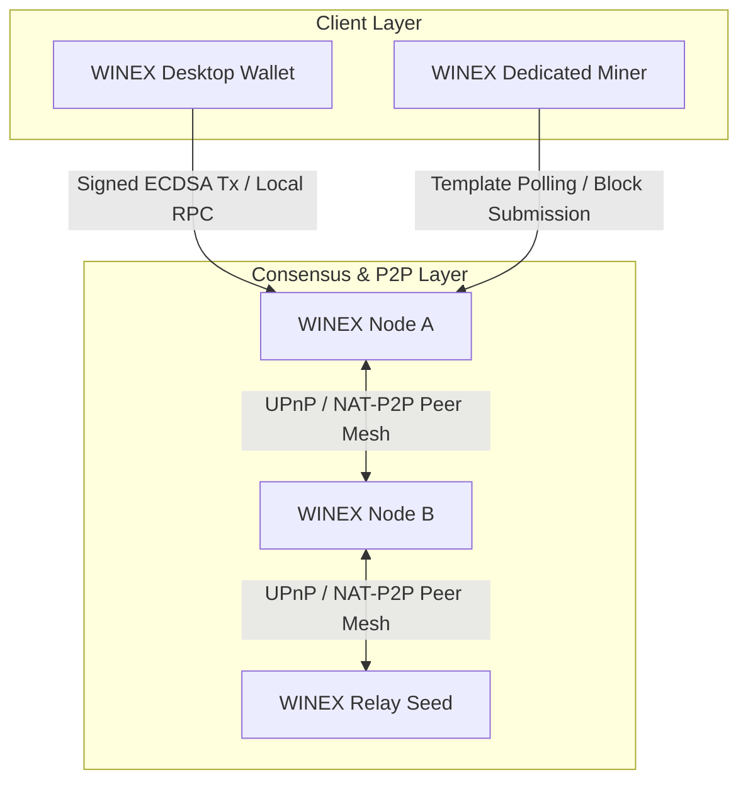

# WINEX Core Architecture Overview

WINEX (WNX) is an autonomous, decentralized Layer-1 proof-of-work blockchain network engineered for long-term monetary scarcity, deterministic block rewards, and sovereign peer-to-peer transaction finality.

## Component Architecture

### 1. WINEX Node (`cmd/winex-node`)
- **Consensus Engine:** Validates double-pass SHA-256 PoW blocks, verifies deterministic Merkle roots, enforces immutable halving schedules, and prevents reorganization attacks beyond `MAX_REORG_DEPTH = 10`.
- **Transaction Engine:** Verifies secp256k1 ECDSA digital signatures, ensures deterministic address derivation (`WNX` + SHA256 prefix), executes balance checks, and defends against replay attacks using active signature registries.
- **P2P Networking:** Automatic NAT-P2P port mapping with UPnP, LAN peer broadcast discovery (`239.255.255.250:1900`), and safe public peer mesh validation with strict RFC 1918 / loopback SSRF rejection.
- **JSON-RPC & REST API:** Standard Bitcoin-compatible JSON-RPC (`getinfo`, `getblock`, `getbalance`, `sendrawtransaction`, `getmininginfo`) plus high-throughput REST endpoints.

### 2. WINEX Wallet (`cmd/winex-wallet`)
- **Key Derivation:** BIP-39 deterministic 12-word recovery seed with hierarchical deterministic (HD) account indexing (`m/44'/0'/0'/0/i`).
- **Encrypted Cold Vault:** AES-256-GCM authenticated encryption secured with PBKDF2 (100,000 iterations, SHA-256, 16-byte random salt).
- **Interface:** Dual architecture supporting both native Qt6 graphical desktop interface and an embedded webview application.
- **Security:** Ephemeral loopback binding (`127.0.0.1:0`), cryptographically secure CSRF session token validation, and constant-time token comparison.

### 3. WINEX Dedicated Miner (`cmd/winex-miner`)
- **Dual Engine:** OpenCL 3.0 GPU Hardware Acceleration (NVIDIA CUDA / AMD Radeon / Intel Arc) and multi-core parallel CPU workers.
- **Consensus Hash:** Double-pass SHA-256 with deterministic address-bound salt:
  $$\text{Hash}_1 = \text{SHA256}(\text{Index} : \text{PrevHash} : \text{Merkle} : \text{Miner} : \text{Timestamp} : \text{Nonce})$$
  $$\text{Salt} = \text{SHA256}(\text{Miner} + \text{Prefix}_{16})$$
  $$\text{PowHash} = \text{SHA256}(\text{Hash}_1 + \text{Salt})$$
- **Network Synchronization:** Automatic clock skew synchronization against server block templates to ensure valid consensus timestamps.
